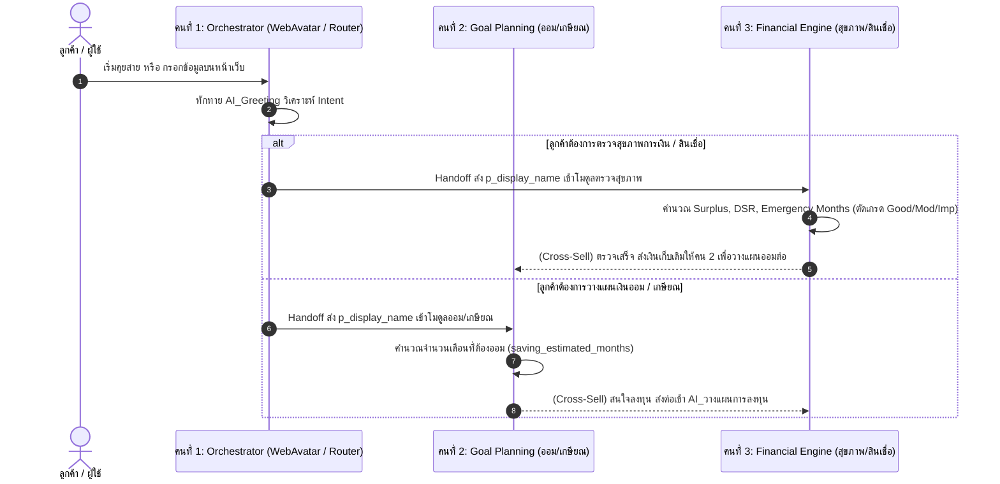

# แผนผังสถาปัตยกรรมระบบ (Project Architecture & Code Ownership)
**โครงการ:** พัฒนาระบบ Voice Bot น้องเบลล่า (Bella Voice Bot)  
**รูปแบบการทำงาน:** 3-Lead Collaborative Architecture

---

## 1. ผังโครงสร้างโฟลเดอร์และการแบ่งงาน (Directory & Ownership Tree)

```text
Voice-Bot-Bella/
├── index.html                           # [HTML กลาง] แบ่ง Section ชัดเจนตาม 3 บทบาท
├── style.css                            # [CSS กลาง] FinTech Design System & Tokens
├── app.js                               # [Main Entry Point] รวมและเรียกใช้ทั้ง 3 โมดูล
│
├── js/                                  # 📂 โฟลเดอร์แยกโค้ด JavaScript ตามบทบาท 3 คน
│   ├── person1-orchestrator.js          # 🔵 [คนที่ 1] WebAvatar SDK, State Store, Events & Routing
│   ├── person2-goal-planning.js         # 🟢 [คนที่ 2] AI_วางแผนการออม & AI_วางแผนการเกษียณ
│   └── person3-financial-engine.js      # 🟡 [คนที่ 3] AI_ตรวจสุขภาพการเงิน, DSR, เครื่องคำนวณสินเชื่อ
│
├── เอกสารสัญญาและพิมพ์เขียว (Framework Blueprints):
│   ├── STATE_CONTRACT.md                # 📜 สัญญาตกลงข้อมูลกลาง (State Contract) ขจัด Handoff State Loss
│   ├── SESSION_STATE_SCHEMA.json        # 📐 มาตรฐาน JSON Schema สำหรับตรวจสอบ State
│   ├── MASTER_ROUTER_PROMPT.md          # 🧠 พิมพ์เขียว System Prompt ของ AI_Greeting (คนที่ 1)
│   ├── GUIDE_PERSON_2_GOAL_PLANNING.md  # 📘 คู่มือปฏิบัติงานและสอนงานคนที่ 2 (การออม & เกษียณ)
│   └── GUIDE_PERSON_3_FINANCIAL_ENGINE.md# 📙 คู่มือปฏิบัติงานและสอนงานคนที่ 3 (ตรวจสุขภาพ & ลงทุน)
│
└── .agents/skills/webavatar-widget/     # 🤖 Skill ติดตั้ง WebAvatar สำหรับ AI Coding Agent
```

---

## 2. ตารางแบ่งแยกหน้าที่และความรับผิดชอบของโค้ด (Ownership Matrix)

| บุคลากร | โมดูล Voice Bot ที่รับผิดชอบ | ไฟล์โค้ดหน้าบ้าน (Front-end File) | ส่วนประกอบใน `index.html` | ไฟล์คู่มือ & Prompt |
| :--- | :--- | :--- | :--- | :--- |
| **คนที่ 1**<br>*(Core Framework)* | • `AI_Greeting`<br>• Global Fallback (3 นาที / Gibberish 3x)<br>• SaaS-FAQ Integration | [`js/person1-orchestrator.js`](file:///d:/Voice-Bot-Bella/js/person1-orchestrator.js) | • `<header>` & ปุ่มคุยสาย<br>• Section `#faq`<br>• Dialog `#settings-modal` | • [`MASTER_ROUTER_PROMPT.md`](file:///d:/Voice-Bot-Bella/MASTER_ROUTER_PROMPT.md)<br>• [`STATE_CONTRACT.md`](file:///d:/Voice-Bot-Bella/STATE_CONTRACT.md) |
| **คนที่ 2**<br>*(Goal Planning)* | • `AI_วางแผนการออม`<br>• `AI_วางแผนการเกษียณ`<br>• Cross-Sell Handoff ไปหาคนที่ 3 | [`js/person2-goal-planning.js`](file:///d:/Voice-Bot-Bella/js/person2-goal-planning.js) | • Section `#deposits` (เงินฝาก & จำลองออม)<br>• Section `#retirement` (วางแผนเกษียณ) | • [`GUIDE_PERSON_2_GOAL_PLANNING.md`](file:///d:/Voice-Bot-Bella/GUIDE_PERSON_2_GOAL_PLANNING.md) |
| **คนที่ 3**<br>*(Financial Engine)* | • `AI_ตรวจสุขภาพการเงินเบื้องต้น`<br>• `AI_วางแผนการลงทุน`<br>• 4 Math Formulas & 3-Tier Diagnostic | [`js/person3-financial-engine.js`](file:///d:/Voice-Bot-Bella/js/person3-financial-engine.js) | • Section `#quiz` (ตรวจสุขภาพ 4 Step)<br>• Section `#loans` (ประเภทสินเชื่อ)<br>• Section `#calculator` (คำนวณค่างวด) | • [`GUIDE_PERSON_3_FINANCIAL_ENGINE.md`](file:///d:/Voice-Bot-Bella/GUIDE_PERSON_3_FINANCIAL_ENGINE.md) |

---

## 3. วงจรการสื่อสารและการไหลของข้อมูล (Data & Event Flow)


