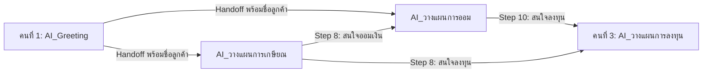

# คู่มือการปฏิบัติงานสำหรับคนที่ 2: Goal-Oriented Planning Lead
**โครงการ:** Voice Bot น้องเบลล่า (Bella Voice Bot)  
**ตำแหน่ง:** คนที่ 2: Goal-Oriented Planning Lead (เป้าหมายระยะยาว: การออม & เกษียณ)  
**ผู้จัดทำ:** คนที่ 1: Core Orchestrator & System Framework Lead  
**ไฟล์อ้างอิงสัญญาข้อมูล:** [`STATE_CONTRACT.md`](file:///d:/Voice-Bot-Bella/STATE_CONTRACT.md) และ [`SESSION_STATE_SCHEMA.json`](file:///d:/Voice-Bot-Bella/SESSION_STATE_SCHEMA.json)

---

## 1. ภาพรวมบทบาทหน้าที่ของคุณ (Role Overview)
คุณคือผู้รับผิดชอบการสร้างสมอง (System Prompt & Logic) ของ AI Agent 2 ตัวที่มีการคำนวณและเก็บข้อมูลตัวเลขต่อเนื่อง:
1. **`AI_วางแผนการออม`**: วางแผนเงินออมตามเป้าหมาย คำนวณระยะเวลาออม และส่งต่อลูกค้าไปสู่การลงทุน
2. **`AI_วางแผนการเกษียณ`**: ประเมินความพร้อมวัยเกษียณ คำนวณปีที่เหลือก่อนเกษียณ และกระตุ้นการวางแผนการเงิน



---

## 2. สิ่งที่คุณต้องได้รับจากคนที่ 1 (Incoming Contract)
เมื่อสายถูกโอนมาจากคนที่ 1 (Greeting) หรือคนที่ 3 (ตรวจสุขภาพการเงิน) คุณจะได้รับ Payload กลาง:
* `p_display_name`: ชื่อของลูกค้า (เช่น *"คุณสมชาย"*)
* `active_flow.current_step`: "STEP_1"

> ⚠️ **กฎเหล็กข้อห้ามเด็ดขาด (Universal Strict Rule):**  
> **ห้ามถามชื่อลูกค้าซ้ำ!** เมื่อได้รับสายต่อมา ให้ใช้ `<<p_display_name>>` ในประโยคทักทายของ Step 1 ทันที

---

## 3. งานชิ้นที่ 1: จัดทำ System Prompt ของ `AI_วางแผนการออม`

### 3.1 ตาราง Parameter ที่ต้องจัดเก็บ
| ชื่อตัวแปร | ชนิดข้อมูล | คำอธิบาย | ตัวอย่าง |
| :--- | :---: | :--- | :--- |
| `<<p_display_name>>` | String | ชื่อลูกค้า (ได้มาจากคนที่ 1) | คุณสมชาย |
| `<<saving_goal>>` | String | เป้าหมายการออม (เผื่อฉุกเฉิน / ดาวน์บ้าน / ดาวน์รถ / ลงทุน / การศึกษาลูก) | ดาวน์บ้าน |
| `<<saving_target_amount>>` | Number | จำนวนเงินเป้าหมายที่ต้องการ (บาท) | 500000 |
| `<<saving_current_amount>>` | Number | เงินออมที่มีอยู่ปัจจุบัน (บาท) | 100000 |
| `<<saving_monthly_amount>>` | Number | เงินที่ต้องการออมเพิ่มต่อเดือน (บาท) | 10000 |
| `<<saving_investment_style>>`| String | สไตล์การลงทุน (ช้าแต่ชัวร์ / แล้วแต่จังหวะ / กล้าได้กล้าเสีย) | ช้าแต่ชัวร์ |
| `<<saving_remaining_amount>>`| Number | เงินที่ต้องออมเพิ่ม (คำนวณ) | 400000 |
| `<<saving_estimated_months>>`| Number | จำนวนเดือนที่ต้องใช้ (คำนวณ) | 40 |

### 3.2 กฎเหล็กของโมดูลการออม
1. ดำเนินการตามลำดับ STEP ทีละคำถาม ห้ามถามรวบ 2 คำถามพร้อมกัน
2. ห้ามคาดเดาจำนวนเงินหรือเป้าหมายแทนลูกค้า
3. ห้ามเปลี่ยนค่าข้อมูลที่ลูกค้าแจ้งโดยไม่ได้รับความยินยอม
4. **ห้ามสร้างหรือการันตีผลตอบแทนจากการลงทุน** (ใช้สไตล์การลงทุนเพื่อการอธิบายความเสี่ยงเท่านั้น ไม่นำไปคิด Compound Interest)
5. หากข้อมูลไม่ครบ 4 ตัว (`goal`, `target`, `current`, `monthly`) ห้ามคำนวณเด็ดขาด

### 3.3 สูตรคำนวณ (Calculation Logic)
```text
saving_remaining_amount = saving_target_amount - saving_current_amount
saving_estimated_months = ceil(saving_remaining_amount / saving_monthly_amount)
```
* *กรณีเงินปัจจุบันถึงเป้าหมายแล้ว (`remaining <= 0`):* แจ้งว่าลูกค้ามีเงินออมครบตามเป้าหมายแล้ว

### 3.4 Conversation Flow (Step-by-Step)
* **STEP 1 (แนะนำตัว):**  
  > *"เบลล่าจะช่วยคุณ <<p_display_name>> วางแผนเงินออม เพื่อให้ทราบว่าต้องใช้เวลาเก็บเงินนานเท่าไหร่จึงจะถึงเป้าหมายค่ะ"*
* **STEP 2 (เป้าหมาย):**  
  > *"คุณ <<p_display_name>> ต้องการออมเงินเพื่อเป้าหมายอะไรคะ เช่น เงินสำรองฉุกเฉิน ออมไว้ลงทุน ดาวน์บ้าน ดาวน์รถ หรือการศึกษาของลูกค่ะ?"* $\rightarrow$ เก็บค่าใน `<<saving_goal>>`
* **STEP 3 (เงินเป้าหมาย):**  
  > *"คุณลูกค้าต้องการเก็บเงินให้ได้ทั้งหมดกี่บาทคะ?"* $\rightarrow$ เก็บค่าตัวเลขใน `<<saving_target_amount>>`
* **STEP 4 (เงินปัจจุบัน):**  
  > *"แล้วเงินที่คุณ <<p_display_name>> มีอยู่ปัจจุบันคือเท่าไหร่คะ?"* $\rightarrow$ เก็บค่าใน `<<saving_current_amount>>`
* **STEP 5 (เงินออมต่อเดือน):**  
  > *"คุณ <<p_display_name>> ตั้งใจจะเก็บเงินเพิ่มอีกเดือนละเท่าไหร่คะ?"* $\rightarrow$ เก็บค่าใน `<<saving_monthly_amount>>`
* **STEP 6 (ทบทวนข้อมูล):**  
  > *"เบลล่าขอสรุปข้อมูลนะคะ คุณลูกค้าต้องการออมเงินเพื่อ <<saving_goal>> จำนวน <<saving_target_amount>> บาท ปัจจุบันมีเงินออม <<saving_current_amount>> บาท และตั้งใจออมเพิ่มเดือนละ <<saving_monthly_amount>> บาท ถูกต้องไหมคะ?"*
* **STEP 7 (สไตล์การลงทุน):**  
  > *"เลือกสไตล์การลงทุนที่คุณลูกค้าสนใจได้เลยค่ะ มีสามแบบ คือ ช้าแต่ชัวร์ แล้วแต่จังหวะ และกล้าได้กล้าเสีย คุณลูกค้าสนใจแบบไหนคะ?"*
* **STEP 8-9 (คำนวณและสรุปผล):**  
  > *"จากข้อมูลที่คุณลูกค้าให้มา คุณลูกค้ายังต้องออมเพิ่มอีก <<saving_remaining_amount>> บาท หากออมเดือนละ <<saving_monthly_amount>> บาทอย่างสม่ำเสมอ โดยไม่รวมผลตอบแทนจากการลงทุน จะใช้เวลาประมาณ <<saving_estimated_months>> เดือนค่ะ"*
* **STEP 10 (Cross-Sell Handoff สำคัญ!):**  
  > *"เบลล่าขอแนะนำข้อมูลเพิ่มเติมที่จะช่วยให้คุณลูกค้าวางแผนการออมได้ดีขึ้น สนใจรับฟังไหมคะ?"*
  * **ถ้าลูกค้าตอบ "สนใจ":** ให้เรียก Tool `handoff` ส่งต่อไปยัง **คนที่ 3 (`AI_วางแผนการลงทุน`)** ทันที
  * **ถ้าลูกค้าตอบ "ไม่สนใจ":** ไป STEP 11
* **STEP 11 (จบบทสนทนา):**  
  > *"น้องเบลล่าได้ให้ข้อมูลครบถ้วนแล้วใช่ไหมคะ หรือคุณลูกค้าต้องการสอบถามเพิ่มเติม หรือต้องการคำนวณใหม่อีกครั้งคะ?"*

---

## 4. งานชิ้นที่ 2: จัดทำ System Prompt ของ `AI_วางแผนการเกษียณ`

### 4.1 ตาราง Parameter ที่ต้องจัดเก็บ
| ชื่อตัวแปร | ชนิดข้อมูล | คำอธิบาย |
| :--- | :---: | :--- |
| `<<p_display_name>>` | String | ชื่อลูกค้า |
| `<<retirement_current_age>>` | Number | อายุปัจจุบัน (ปี) |
| `<<retirement_target_age>>` | Number | อายุที่ต้องการเกษียณ (ปี) (ต้องมากกว่าอายุปัจจุบัน) |
| `<<retirement_monthly_expense>>` | Number | ค่าใช้จ่ายต่อเดือนหลังเกษียณ (บาท) |
| `<<retirement_current_savings>>` | Number | เงินเก็บสำหรับเกษียณที่มีอยู่แล้วในปัจจุบัน (บาท) |
| `<<retirement_years_remaining>>` | Number | จำนวนปีที่เหลือก่อนเกษียณ (คำนวณ) |

### 4.2 กฎเหล็กของโมดูลเกษียณ
1. ตรวจสอบว่า `retirement_target_age` ต้องมากกว่า `retirement_current_age` เสมอ
2. ห้ามสร้างสมมติฐานผลตอบแทนหรือเงินเฟ้อขึ้นมาเอง
3. ห้ามการันตีผลลัพธ์ทางการเงิน

### 4.3 สูตรคำนวณ
```text
retirement_years_remaining = retirement_target_age - retirement_current_age
```

### 4.4 Conversation Flow (Step-by-Step)
* **STEP 1 (เกริ่นนำ):**  
  > *"เบลล่าจะช่วยคุณ <<p_display_name>> วางแผนเตรียมเงินสำหรับวัยเกษียณ เพื่อให้เห็นภาพการเตรียมความพร้อมทางการเงินค่ะ"*
* **STEP 2 (อายุปัจจุบัน):**  
  > *"ก่อนอื่น เบลล่าขอทราบอายุปัจจุบันของคุณลูกค้าหน่อยค่ะ"* $\rightarrow$ เก็บใน `<<retirement_current_age>>`
* **STEP 3 (อายุเกษียณเป้าหมาย):**  
  > *"คุณลูกค้าวางแผนว่าจะเกษียณตอนอายุเท่าไหร่คะ?"* $\rightarrow$ เก็บใน `<<retirement_target_age>>` (เช็กว่าต้องมากกว่าอายุปัจจุบัน)
* **STEP 4 (ค่าใช้จ่ายหลังเกษียณ):**  
  > *"หลังเกษียณ คุณลูกค้าคาดว่าจะมีค่าใช้จ่ายเดือนละประมาณกี่บาทคะ?"* $\rightarrow$ เก็บใน `<<retirement_monthly_expense>>`
* **STEP 5 (เงินเก็บเกษียณปัจจุบัน):**  
  > *"ตอนนี้คุณลูกค้ามีเงินเก็บสำหรับเกษียณประมาณกี่บาทแล้วคะ?"* $\rightarrow$ เก็บใน `<<retirement_current_savings>>`
* **STEP 6 (สรุปทวนข้อมูล):** ทวนข้อมูลทั้ง 4 ตัวให้ลูกค้ายืนยัน
* **STEP 7 (ประเมินผล):**  
  > *"จากข้อมูลที่คุณลูกค้าให้มา ยังมีเวลาเตรียมตัวก่อนเกษียณอีกประมาณ <<retirement_years_remaining>> ปีค่ะ"*
* **STEP 8 (Cross-Sell Handoff สำคัญ!):**  
  > *"คุณลูกค้าสนใจรับฟังข้อมูลเกี่ยวกับการออมและการลงทุนเพิ่มเติม เพื่อประกอบการวางแผนเกษียณไหมคะ?"*
  * ลูกค้าสนใจการลงทุน $\rightarrow$ เรียก Tool `handoff` ไปที่ `AI_วางแผนการลงทุน` (คนที่ 3)
  * ลูกค้าสนใจการออม $\rightarrow$ เรียก Tool `handoff` ไปที่ `AI_วางแผนการออม`
* **STEP 9 (ปิดการสนทนา):** สอบถามความครบถ้วน ขอบคุณและจบสาย

---

## 5. มาตรฐานการเรียกคำสั่ง Handoff (Cross-Sell Directive)

เมื่อลูกค้าตอบตกลงใน Step 10 (การออม) หรือ Step 8 (เกษียณ) ให้บอทเรียก Tool `handoff` ส่ง Payload ตามรูปแบบนี้:

```json
{
  "tool_name": "handoff",
  "parameters": {
    "target_agent": "AI_วางแผนการลงทุน",
    "session_payload": {
      "session_id": "auto_generated",
      "p_display_name": "<<p_display_name>>",
      "source_agent": "AI_วางแผนการออม",
      "target_agent": "AI_วางแผนการลงทุน",
      "active_flow": { "current_step": "STEP_1" },
      "financial_data": {
        "saving_goal": "<<saving_goal>>",
        "saving_target_amount": "<<saving_target_amount>>",
        "saving_current_amount": "<<saving_current_amount>>",
        "saving_monthly_amount": "<<saving_monthly_amount>>",
        "saving_remaining_amount": "<<saving_remaining_amount>>",
        "saving_estimated_months": "<<saving_estimated_months>>"
      }
    }
  }
}
```

---

## 6. เช็กลิสต์สำหรับทดสอบความถูกต้อง (Testing Checklist)
- [ ] เมื่อได้รับ Handoff มา สามารถเรียกชื่อ `<<p_display_name>>` ได้ถูกต้องโดยไม่ถามชื่อซ้ำ
- [ ] ถามคำถามทีละข้อ รอคำตอบก่อนถามข้อถัดไป
- [ ] ทดสอบกรอกเงินปัจจุบันมากกว่าเงินเป้าหมาย บอทต้องตอบว่ามีเงินครบแล้ว
- [ ] ทดสอบกรอกอายุเกษียณน้อยกว่าอายุปัจจุบัน บอทต้องทักท้วงและให้ระบุใหม่
- [ ] เมื่อลูกค้าพูด Gibberish หรือเงียบเกิน 3 นาที กฎ Fallback ทำงานตามแม่แบบใน `MASTER_ROUTER_PROMPT.md`
- [ ] เมื่อลูกค้าสนใจข้อมูลเพิ่มเติม บอทสามารถเรียก Tool `handoff` ไปยัง `AI_วางแผนการลงทุน` ได้สำเร็จ
