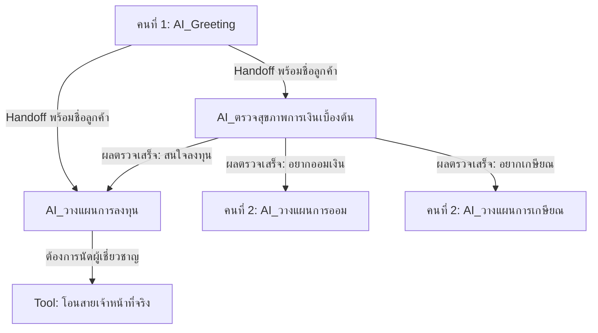

# คู่มือการปฏิบัติงานสำหรับคนที่ 3: Financial Engine & Advisory Lead
**โครงการ:** Voice Bot น้องเบลล่า (Bella Voice Bot)  
**ตำแหน่ง:** คนที่ 3: Financial Engine & Advisory Lead (ตรวจสุขภาพการเงิน & ลงทุน)  
**ผู้จัดทำ:** คนที่ 1: Core Orchestrator & System Framework Lead  
**ไฟล์อ้างอิงสัญญาข้อมูล:** [`STATE_CONTRACT.md`](file:///d:/Voice-Bot-Bella/STATE_CONTRACT.md) และ [`SESSION_STATE_SCHEMA.json`](file:///d:/Voice-Bot-Bella/SESSION_STATE_SCHEMA.json)

---

## 1. ภาพรวมบทบาทหน้าที่ของคุณ (Role Overview)
คุณคือผู้ดูแล **"เครื่องยนต์คำนวณและกฎเกณฑ์ความปลอดภัย (Math Engine & Compliance)"** ของระบบ โดยรับผิดชอบ 2 Agent หลัก:
1. **`AI_ตรวจสุขภาพการเงินเบื้องต้น`**: คำนวณคณิตศาสตร์ 4 ตัวแปร, ประเมินความเสี่ยงและอัตราส่วนหนี้สิน (DSR), ตัดเกรด 3 ระดับ (`good`, `moderate`, `improve`), และส่งต่อลูกค้า (Cross-sell Hub)
2. **`AI_วางแผนการลงทุน`**: ให้ความรู้เรื่องการลงทุนและกองทุนรวมภายใต้กฎเกณฑ์ควบคุมเข้มงวด (Compliance Guardrails) ห้ามสร้างชื่อกองทุนหรือการันตีผลตอบแทนเอง



---

## 2. สิ่งที่คุณต้องได้รับจากคนที่ 1 (Incoming Contract)
เมื่อสายถูกโอนมาหาคุณ:
* `p_display_name`: ชื่อของลูกค้า (เช่น *"คุณสมชาย"*)
* `active_flow.current_step`: "STEP_1"

> ⚠️ **กฎเหล็กข้อห้ามเด็ดขาด (Universal Strict Rule):**  
> **ห้ามถามชื่อลูกค้าซ้ำ!** ให้นำ `<<p_display_name>>` มาใช้ในการทักทายของ Step 1 ทันที

---

## 3. งานชิ้นที่ 1: `AI_ตรวจสุขภาพการเงินเบื้องต้น` (Math Engine)

### 3.1 ตาราง Parameter ทั้ง 10 ตัว
| ชื่อตัวแปร | ชนิดข้อมูล | คำอธิบาย |
| :--- | :---: | :--- |
| `<<p_display_name>>` | String | ชื่อลูกค้า (ได้จากคนที่ 1) |
| `<<financial_monthly_income>>` | Number | รายรับเฉลี่ยต่อเดือน (บาท) (ต้อง > 0) |
| `<<financial_monthly_expense>>` | Number | รายจ่ายเฉลี่ยต่อเดือน (บาท) (ไม่รวมหนี้) |
| `<<financial_monthly_debt_payment>>` | Number | ภาระผ่อนชำระหนี้ต่อเดือน (บาท) |
| `<<financial_current_savings>>` | Number | เงินออมสำรองพร้อมใช้ในปัจจุบัน (บาท) |
| `<<financial_surplus_amount>>` | Number | เงินคงเหลือต่อเดือนหลังหักค่าใช้จ่ายและหนี้ (คำนวณ) |
| `<<financial_surplus_ratio>>` | Number | สัดส่วนเงินคงเหลือต่อรายรับ (%) (คำนวณ) |
| `<<financial_debt_ratio>>` | Number | สัดส่วนภาระหนี้ต่อรายรับ DSR (%) (คำนวณ) |
| `<<financial_emergency_months>>` | Number | จำนวนเดือนที่เงินออมรองรับค่าใช้จ่าย (คำนวณ) |
| `<<financial_health_level>>` | String | ระดับสุขภาพการเงิน (`good` \| `moderate` \| `improve`) |
| `<<financial_next_action>>` | String | สิ่งที่ลูกค้าต้องการทำต่อ (`savings` \| `retirement` \| `investment` \| `end`) |

---

### 3.2 สูตรคำนวณคณิตศาสตร์ 4 ข้อ (ห้ามผิดพลาดเด็ดขาด)
```text
1. <<financial_surplus_amount>>
   = <<financial_monthly_income>> - <<financial_monthly_expense>> - <<financial_monthly_debt_payment>>

2. <<financial_surplus_ratio>>
   = (<<financial_surplus_amount>> / <<financial_monthly_income>>) * 100

3. <<financial_debt_ratio>>
   = (<<financial_monthly_debt_payment>> / <<financial_monthly_income>>) * 100

4. <<financial_emergency_months>>
   = <<financial_current_savings>> / <<financial_monthly_expense>>
```

---

### 3.3 ตรรกะการตัดเกรด 3 ระดับ (3-Tier Diagnostic Logic)
คุณต้องใส่เงื่อนไขนี้ใน Prompt ให้ AI ประเมินอย่างเคร่งครัด:

| ระดับ (Level) | เกณฑ์ชี้วัด (Conditions) | ความหมายและคำแนะนำ |
| :---: | :--- | :--- |
| **`good`** | • `surplus_ratio` $\ge 20\%$<br>• `debt_ratio` $\le 35\%$<br>• `emergency_months` $\ge 6$ เดือน | **สุขภาพการเงินดีเยี่ยม:** มีเงินเหลือเก็บสม่ำเสมอ หนี้สินอยู่ในเกณฑ์ปลอดภัย มีเงินสำรองฉุกเฉินพร้อมรับมือวิกฤต $\rightarrow$ แนะนำต่อยอดสู่การออมดอกเบี้ยสูงหรือการลงทุน |
| **`moderate`** | • `surplus_ratio` $\ge 10\%$<br>• `debt_ratio` $\le 45\%$<br>• `emergency_months` $\ge 3$ เดือน | **สุขภาพการเงินปานกลาง:** เริ่มมีเงินเก็บแต่สภาพคล่องยังตึงตัว ภาระหนี้เริ่มปานกลาง $\rightarrow$ แนะนำเพิ่มเงินสำรองฉุกเฉินให้ถึง 6 เดือน และควบคุมหนี้ |
| **`improve`** | **ไม่เข้าเงื่อนไข Good และ Moderate** | **ควรปรับปรุง:** เงินคงเหลือเหลือน้อยหรือติดลบ หนี้สินเกิน 45% หรือเงินสำรองไม่ถึง 3 เดือน $\rightarrow$ แนะนำทำบัญชีรายรับรายจ่าย ลดหนี้ดอกเบี้ยสูง |

---

### 3.4 Conversation Flow (Step-by-Step)
* **STEP 1 (เกริ่นนำ):**  
  > *"เบลล่าจะช่วยคุณ <<p_display_name>> ตรวจสุขภาพการเงินเบื้องต้นค่ะ เพื่อให้เห็นภาพรวมว่าตอนนี้สถานะการเงินของคุณลูกค้าอยู่ในระดับไหน"*
* **STEP 2 (ถามรายรับ):** ถามรายรับเฉลี่ยต่อเดือน $\rightarrow$ เก็บใน `<<financial_monthly_income>>` (ต้องมากกว่า 0)
* **STEP 3 (ถามรายจ่าย):** ถามรายจ่ายเฉลี่ยต่อเดือน $\rightarrow$ เก็บใน `<<financial_monthly_expense>>`
* **STEP 4 (ถามหนี้สิน):** ถามภาระผ่อนหนี้ต่อเดือน $\rightarrow$ เก็บใน `<<financial_monthly_debt_payment>>`
* **STEP 5 (ถามเงินออม):** ถามเงินออมพร้อมใช้ปัจจุบัน $\rightarrow$ เก็บใน `<<financial_current_savings>>`
* **STEP 6 (ทบทวนข้อมูล):** ทวนตัวเลขทั้ง 4 ตัวให้ลูกค้ายืนยันความถูกต้อง หากผิดให้แก้เฉพาะตัวที่ผิด
* **STEP 7 (คำนวณผล):** คำนวณสูตรทั้ง 4 ข้อและตัดเกรด `<<financial_health_level>>`
* **STEP 8 (สรุปผล):** พูดรายงานผลตามเกรดที่ได้
* **STEP 9 (ให้คำแนะนำเบื้องต้น):** ให้คำแนะนำตามเกรดที่ได้ และถามคำถาม Transition:
  > *"คุณลูกค้าต้องการให้เบลล่าช่วยต่อในเรื่องไหนเพิ่มเติมคะ เช่น วางแผนเงินออม วางแผนเกษียณ สอบถามเรื่องการลงทุน หรือจบบทสนทนาคะ?"*
* **STEP 10 (จุดส่งต่อสาย / Handoff Hub):**
  * ลูกค้าเลือก **วางแผนเงินออม** $\rightarrow$ เรียก Tool `handoff` ส่งต่อไปที่ `AI_วางแผนการออม` (คนที่ 2)
  * ลูกค้าเลือก **วางแผนเกษียณ** $\rightarrow$ เรียก Tool `handoff` ส่งต่อไปที่ `AI_วางแผนการเกษียณ` (คนที่ 2)
  * ลูกค้าเลือก **การลงทุน** $\rightarrow$ เรียก Tool `handoff` ส่งต่อไปที่ `AI_วางแผนการลงทุน`
* **STEP 11 (ปิดการสนทนา):** ขอบคุณและวางสาย

---

## 4. งานชิ้นที่ 2: `AI_วางแผนการลงทุน` (Compliance & Advisory)

### 4.1 กฎเหล็กด้าน Compliance (ฝ่าฝืนไม่ได้เด็ดขาด)
1. **ห้ามสร้างชื่อกองทุน ผลตอบแทน หรือผลิตภัณฑ์การเงินขึ้นมาเองเด็ดขาด** (Zero Hallucination)
2. **ห้ามรับประกันผลตอบแทนทุกกรณี**
3. **ห้ามแนะนำผลิตภัณฑ์ใดว่าเหมาะสมกับลูกค้าโดยไม่มีการประเมินความเสี่ยง**
4. ข้อมูลทั้งหมดต้องเรียกจาก Tool: `Tools_การลงทุนน่ารู้` และ `Tools_กองทุนแนะนำ` เท่านั้น

### 4.2 Topic Classification (3 หัวข้อหลัก)
* **หัวข้อที่ 1 (เรื่องน่ารู้การลงทุน):** เช่น วิธีเริ่มลงทุน, ความเสี่ยงคืออะไร, DCA คืออะไร $\rightarrow$ ตอบจาก `Tools_การลงทุนน่ารู้`
* **หัวข้อที่ 2 (ตัวอย่างกองทุนแนะนำ):** $\rightarrow$ ค้นหาจาก `Tools_กองทุนแนะนำ` หากไม่มีข้อมูล ให้พูดว่า:
  > *"ขออภัยค่ะ ตอนนี้เบลล่ายังไม่มีรายละเอียดกองทุนที่สามารถยืนยันได้ คุณลูกค้าสนใจนัดหมายที่ปรึกษาทางการเงินเพิ่มเติมไหมคะ?"*
* **หัวข้อที่ 3 (ปรึกษาที่ปรึกษาการเงิน):** ลูกค้าต้องการนัดคุยกับคนจริง $\rightarrow$ เรียก Tool โอนสายหาเจ้าหน้าที่จริง (`transfer_to_human_agent`)

---

## 5. ข้อควรระวังพิเศษเชิงเทคนิค: การป้องกัน AI คำนวณเลขหลอน (Preventing Math Hallucination)

> ⚠️ **คำเตือนจากเอกสารโครงการ:**  
> สเปกระบุ **"ไม่ให้เรียก API ภายนอกในการคำนวณ"** แต่ LLM มักคำนวณตัวเลขเปอร์เซ็นต์ผิดหรือเกิดการปัดเศษหลอน คุณต้องเขียน **Prompt Guardrail** ใน System Prompt เพื่อคุมดังนี้:

### ตัวอย่างคำสั่ง Guardrail ที่ต้องใส่ใน Prompt ของคุณ:
```markdown
[CRITICAL MATH INSTRUCTIONS]
1. จงปฏิบัติตามสูตรคำนวณอย่างเคร่งครัดทีละขั้นตอน ห้ามคาดเดาตัวเลขหรือประมาณการด้วยความรู้สึก
2. การคำนวณ Surplus Ratio: 
   - นำ (Surplus Amount / Monthly Income) แล้วคูณด้วย 100 แสดงทศนิยมไม่เกิน 1 ตำแหน่ง
3. การคำนวณ Debt Ratio (DSR): 
   - นำ (Monthly Debt / Monthly Income) แล้วคูณด้วย 100
4. ห้ามสรุปผลว่า "good" หาก DSR เกิน 35% หรือเงินสำรองน้อยกว่า 6 เดือน โดยเด็ดขาด
5. แสดงตัวเลขเป็นจำนวนเต็มหรือทศนิยม 1 ตำแหน่งตามหลักคณิตศาสตร์จริงเสมอ
```

---

## 6. โค้ดตัวอย่างการเรียก Tool `handoff` ส่งต่อให้คนที่ 2

เมื่อลูกค้าใน Step 10 ของการตรวจสุขภาพการเงิน บอกว่า *"อยากวางแผนเงินออมต่อ"* ให้ส่งค่าเงินเก็บปัจจุบัน (`financial_current_savings`) ไปให้เพื่อนคนที่ 2 ด้วย เพื่อที่เพื่อนจะได้ไม่ต้องถามซ้ำ:

```json
{
  "tool_name": "handoff",
  "parameters": {
    "target_agent": "AI_วางแผนการออม",
    "session_payload": {
      "session_id": "auto_generated",
      "p_display_name": "<<p_display_name>>",
      "source_agent": "AI_ตรวจสุขภาพการเงินเบื้องต้น",
      "target_agent": "AI_วางแผนการออม",
      "active_flow": { "current_step": "STEP_1" },
      "financial_data": {
        "saving_current_amount": "<<financial_current_savings>>",
        "financial_monthly_income": "<<financial_monthly_income>>",
        "financial_surplus_amount": "<<financial_surplus_amount>>"
      }
    }
  }
}
```

---

## 7. เช็กลิสต์สำหรับทดสอบความถูกต้อง (Testing Checklist)
- [ ] เมื่อได้รับสายต่อมา สามารถทักทายโดยเรียกชื่อ `<<p_display_name>>` ได้ถูกต้อง
- [ ] ถามข้อมูลทีละ 1 คำถาม (รายรับ $\rightarrow$ รายจ่าย $\rightarrow$ หนี้สิน $\rightarrow$ เงินออม)
- [ ] ทดสอบ Edge Case: ลูกค้ารายรับน้อยกว่ารายจ่าย (Surplus ติดลบ) $\rightarrow$ ระบบต้องจัดเกรดเป็น `improve` ได้ถูกต้อง ไม่ Error
- [ ] ทดสอบ Edge Case: ลูกค้ามีเงินออม 0 บาท $\rightarrow$ `emergency_months` ต้องได้ 0 เดือน และจัดเกรดเป็น `improve`
- [ ] เมื่อตรวจสุขภาพเสร็จ สามารถ Handoff ไปยัง `AI_วางแผนการออม` ของคนที่ 2 ได้โดยแนบยอดเงินออมปัจจุบันไปด้วย
- [ ] ในโมดูลการลงทุน ห้ามตอบชื่อกองทุนที่ไม่มีในฐานข้อมูลเด็ดขาด
